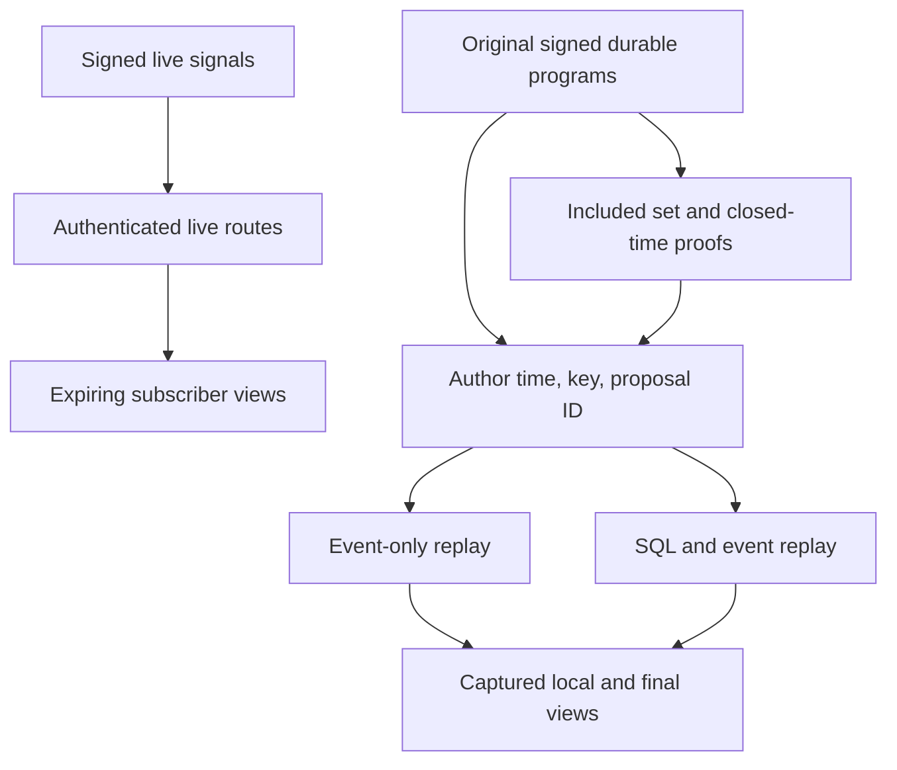

# Chronolog Design

Status: current design of the unreleased prototype. The transaction contract
is [Specification 10](implementation-specs/10-deterministic-sql-transactions.md);
membership details are in [governance.md](governance.md); row ownership is in
[design-owner-rows.md](design-owner-rows.md).

## 1. What Chronolog is

Chronolog provides independent live signals and a permissioned, peer-to-peer
application log. A signal is a signed, expiring message with no database,
durable operation, replay or finality prerequisite. A durable change program
records bounded events, optionally together with **ordinary SQLite statements**
and platform operations. SQL is an execution profile, not a requirement for
using live messages or durable events.

Every durable replica derives application order from the original signed
`(author_timestamp_ms, signing_public_key, proposal_id)`. Signed genesis selects
the inclusion and finality policy. The built-in **peer** policy uses validator
admission and closure evidence. The built-in **coordinated** policy uses a
pinned signer's inclusion receipts and closed-time promises. These policies
determine which proposals are included and which author-time prefix is closed;
neither chooses a different execution order.

Peers prepare their own durable proposals, retain original records and proofs,
verify history, and materialize the selected profile locally. An earlier
proposal admitted before its timestamp closes can replay the tentative suffix.
An offline proposal first included after its timestamp has closed is rejected;
it does not acquire a new position from arrival order. Neither policy permits
new arrivals to change an already applied final prefix.

Authenticated records and immutable evidence are the durable source of truth;
SQL databases, effective event views and application projections are derived
state. A replica can rebuild available history from another authorized peer.
The selected validator policy or finality signer is needed for new finality,
not for every local read or live message. Page hosting, membership administration,
finality and external-effect execution are separately granted roles.

## 2. Moving parts

A durable group selects one policy and execution profile. Both policies share
record/evidence storage, governance, program codecs and node orchestration.
The standalone signal channel has its own explicit authorization and transport
ports; the governed adapter can reuse current group permissions and connections.

| Piece | Package |
| --- | --- |
| Signed messages, transaction and value codecs, execution manifest | `protocol`, `canonical`, `crypto` |
| Membership: genesis, capability revisions, validation policy | `capabilities` |
| Independent signed live messages, bounded subscriptions and expiry | `signals` |
| Signed feed records, immutable evidence, durable storage ports and replication | `records` |
| Native authenticated SSB connection and SQLite storage | `transport-ssb` |
| Reliable replication and independent live lanes over authenticated RTC sessions | `transport-webrtc`, `agent-service` |
| Public Tendriller application adapter and optional retained-log finality adapter | `transport-tendriller` |
| Node: ingest, history policy, membership activation, enrollment and finality | `node-core`, `control-store` |
| SQL-free event materialization and durable operation recovery | `node-core` |
| Deterministic execution on DoltLite | `materializer-doltlite`, `materializer` |
| Dedicated Worker, OPFS storage, Web Locks and optional WASM SQL engine | `runtime-browser` |
| Native finality service and durable effect/timer workers | `agent-service` |
| Client API, RPC, React hooks, CLI, daemon | `client`, `rpc`, `react`, `apps/*` |
| Experimental workerd execution path | `runtime-workerd` ([plan](workerd-reconstruction-plan.md)) |

Signals use bounded FIFO delivery by default, or explicit `latest` coalescing
for replaceable values. They never enter the durable record log. A successful
send establishes local dispatch, not remote processing. Reconnect starts with
fresh observations; temporary live congestion may lose a message without
invalidating the durable replication session. See the
[signal contract](../packages/signals/README.md) for authentication, expiry,
cancellation and transport bounds.

## 3. Durable programs

A transaction candidate is signed by its author and carries:

- the group, membership revision and validation policy it was written for;
- the author's stable `operationId`;
- `author_timestamp_ms`, fixed by the author;
- the execution manifest digest (profile, implementation and limits);
- a program: an ordered list of bounded literal event emissions and, in the SQL
  profile, SQLite statements with bindings or typed platform operations
  (grant, collective, transfer).

The proposal ID is the digest of its canonical transaction core. Signatures,
encryption envelopes and outer feed records carry that proposal without
changing its identity. Receiving it through another peer, or inside another
outer feed record, does not create another transaction, event or SQL effect.

An event-only program uses the same durable identity, inclusion and finality
rules without loading a SQL engine. A mixed program commits its SQL changes
and event emissions atomically. Rejected programs expose no effective events.
Each event has a stable proposal/ordinal identity and authenticated `origin`
derived from its original signed transaction, separately from application JSON.
Durable event subscriptions expose accepted final events in whole-transaction
batches, with opaque history/filter-bound cursors.

Values are SQLite's own storage classes (NULL, INTEGER, REAL, TEXT, BLOB).
DDL and DML travel in the same stream. Application schema is whatever the
accepted transactions created; the execution manifest identifies the engine
and execution rules, not the application's tables.
Only schema administrators (admins of the `group` collective, starting with the
schema administrator named separately in signed genesis) may run DDL. The
membership root does not receive this role implicitly. The convenience native
bootstrap deliberately grants both roles to its owner.

A transaction that depends on earlier state says so in SQL, usually with
`chronolog_assert(condition, 'code')`. If any statement fails, the transaction
is **rejected** and has no effect; otherwise it is **accepted**. Execution records
the outcome (and a rejection code and step index), with effective events only
from accepted programs. Values returned by SQL statements are not replicated.

An application's stable operation ID is durably bound to the exact prepared
proposal before publication. A lost response or restart resumes that proposal
with its original identity; an established final outcome remains unchanged.
The shared operation journal serializes exact publication recovery. Dependent
application work waits for final acceptance and retains its own state guards;
publication order alone is not a dependency guarantee. A relay adapter retries
the original local record and envelope bytes; it does not keep another outbox.

## 3a. Owner-controlled rows

Every application table is put under owner checks when it is created (no
extra step) and has a `chronolog_owner` column,
stamped with the signer of the transaction that inserted the row (stored as
a small integer id; `chronolog_principals` maps ids to keys).
Platform-generated triggers, enforced by the pinned engine on every replica,
let only the owner, a collective the signer belongs to, or a key the owner
granted access insert, update or delete a row. The root administrator and
schema administrators are ordinary actors under these checks: they cannot
widen anyone's rights, but they may narrow them with ordinary app triggers,
whose writes are themselves checked as the signer. Any violation aborts the
whole transaction (`policy:<table>:<command>`); rows are never skipped.
Ownership moves only by an offer accepted by the recipient; a planned key
change is a bulk transfer. Every reader node holds every row's stored bytes.
[Sealed BLOB columns](sealed-data.md) encrypt selected values to an explicit
per-row reader policy; SQL sees their ciphertext and public metadata.
Ownership controls policy changes without implicitly granting decryption.
See [design-owner-rows.md](design-owner-rows.md).

## 4. Determinism

Every replica runs the pinned execution profile on the same state in the same
fixed chronological order. Event-only replicas materialize accepted event
programs without SQL. For SQL profiles, native and browser hosts inject the
storage and engine adapters; the materializer and deterministic restrictions
are shared. The
engine inputs that do not come from SQL are fixed per
transaction: `'now'` is the author timestamp, `random()` is seeded from the
transaction id, `localtime` is UTC, connection counters start at zero, and
`chronolog_actor()` is the signing key. Platform operations are trusted
TypeScript whose digest is part of the execution manifest. A
short block-list (attachments, transaction control, writing pragmas, temporary
objects, Dolt functions, Chronolog's own tables, storage-dependent functions)
is enforced by SQLite's authorizer. SQL within the declared profile runs under
those checks. Replicas' state digests can be compared (snapshots and the chaos
harness do), so a missed case is detectable rather than silent.

An unavailable or incompatible execution manifest blocks application. Missing
records and decryption keys also block progress. None of these conditions is
converted into a deterministic SQL rejection; the replica retains its previous
applied final revision while waiting for the required input or engine.

## 5. Admission and order

### Peer policy

The signed configuration fixes the validator set and validation policy. A
validator attests a candidate if its author may write and its author timestamp is above the
validator's **acceptance cutoff**: a durable, monotonic bound that trails the
validator's clock by the group's `cutoff_lag_ms`. A candidate is **admitted**
once the attestations a replica sees satisfy the pinned validation policy
(at least N distinct validators). Admission is monotonic.

Before admission, a locally authorized candidate may be selected provisionally
for a preview. That selection can be removed if the candidate is excluded or
loses authorization. An admitted candidate cannot be removed or replaced, but
its application outcome can still change when the provisional suffix replays.
Admission establishes inclusion, not successful SQL execution.

Admitted transactions are ordered by the immutable key

`(author_timestamp_ms, signing_public_key, proposal_id)`.

The node fixes the transport-sequence component of the underlying order key
to zero. Outer feed sequence is replication and fork evidence; it cannot move
a proposal when the same signed content travels over another connection.

Validators never choose the position; more attestations never move it. A
transaction that becomes visible late sorts into its fixed position in the
tentative suffix, which is replayed without changing the final prefix.

Validators publish **heartbeats** with their current cutoff. Once the feeds
of a blocking set of validators are replicated past heartbeats whose cutoffs
exceed time T, no new transaction can be admitted at or before T: everything
before T can become final once the necessary records are present and applied.
Live reader/writer membership changes additionally use signed validator
closures: each fixed validator durably closes the previous revision, and a
replica verifies the complete preceding admission records before activating the
next one. An admission published after that validator's closure cannot count
for the closed revision.

### Signed inclusion and pluggable finality

The configuration fixes the group, execution manifest and finality verifier
ID/parameters. An injected verifier proves inclusion and a closed author-time
frontier; the core always uses the chronological comparator above.

The built-in signed-inclusion verifier uses exact receipt bytes, a rolling hash
and prefix certificates. Independently signed closure records commit a complete
included head and a monotone timestamp cutoff. Receipt positions are proof
enumeration, never application execution order. All prior closures are retained,
so a new first inclusion below its earlier cutoff is rejected consistently on
reconnect and restart. Future-dated included proposals remain pending until a
later closure covers their signed time. SQL and event finality require complete
proofs, required payloads/keys and successful local replay of that prefix.

An exact retry retains its original signed timestamp and outcome. A deliberate
redo after rejection uses a new operation ID and current assumptions; the
runtime never retimestamps a rejected original to make it enter the history.

Certificates are immutable evidence outside the log they certify. The
optional Tendriller adapter maps its public receipt format to this verifier;
the same verifier works against an independent reference log. A stored append
acknowledgment proves neither finality nor SQL success.

## 6. Replication

Each author has an append-only, hash-chained **feed** of signed records
(candidates, attestations, heartbeats and governance messages). The shared
record store also retains content-addressed immutable evidence. Certificates
do not need a mutable author feed or consume its sequence numbers.

The native adapter uses SQLite; the browser runtime supplies durable OPFS
stores. A signed feed record is appended only if it is the next one of its
feed, so feeds have no gaps; a second record at an existing
sequence is kept as fork evidence and quarantines that feed.

The native connection uses Secure Scuttlebutt's authenticated secret handshake.
On each connection a node asks the peer for every feed it wants, after its local
head, and keeps the stream open for new records. A node wants its own feed,
its configured peers' feeds, the administration feed and the feed of every
granted member, so records relay through any connected member. There is no
record size limit beyond that adapter's configurable maximum (64 MiB by
default). Other connections apply their own explicit bounds.

The portable in-process connection exchanges the same signed records and
evidence. The optional Tendriller connection submits exact candidate and
governance envelopes to a retained opaque log, stores returned inclusion proofs in
the same evidence store, and uses existing authenticated connections for hints.
Hints trigger retained reads; they are never required for correctness. Quota
exhaustion, a changed history identity or conflicting restored history stops
progress visibly. Neither Chronolog core nor Tendriller core imports the other.

## 7. Membership and encryption

A group starts from a signed **genesis**; the root administrator then
publishes signed **capability revisions** on the administration feed. The
protocol has three grant roles: writer, validator and reader. Membership
administration belongs to the root key and administration feed pinned in
genesis; it is not a grantable role. Every writer grant declares explicit
`program` rights for SQL, durable-event topics and ephemeral signal topics.
Missing rights never imply SQL access, and one exact grant must cover the
operation. Live enrollment grants ordinary reader/writer membership. The built-in
signed configurations keep the root, administration feed, validator set and validation
policy fixed. Their authoring APIs reject reconfiguration of those components.

Every writer grant declares explicit `ProgramRights`: SQL permission, durable
event topics and ephemeral signal topics. Missing rights never imply SQL
permission. One exact grant must cover a whole program; separate grants are
not pooled to authorize it. Forwarding through another enrolled feed requires
an explicit `forwarded: true`. An enrollment approval can narrow requested
rights but cannot widen them.

A joining device persists its own signing and reader keys and an exact signed
request. An authorized issuer approves explicit roles and historical access
through the live client/RPC workflow. Readiness requires active grants, the
required keys, the matching engine and application of the captured final
target. A descriptor supplies authenticated bootstrap configuration, not a
bearer grant. Database membership and a relay's host permissions are distinct.

Receiving governance does not activate it. Verified chronological closure
boundaries determine when a new revision takes effect. Revocation is
prospective in that order: earlier final outcomes remain unchanged, and a later
regrant does not revive a revoked capability or a previously rejected proposal.

Application bodies are encrypted with per-epoch keys. The administrator rotates epochs
and wraps each epoch key to every reader's HPKE key; historical epochs are
given to a reader only by an explicit administrator action. A replica can
receive verified governance and historical keys from a complete certified
prefix before replaying its earlier encrypted programs. Membership activation still
follows its signed causal chain and proved author-time closure boundary.

## 8. Materialization

The node passes the fixed chronological order to the selected materializer,
which does not independently re-sort it. The SQL-free materializer persists its
applied event history and final boundary. In the SQL profile each published
revision is a Dolt commit (`chronolog_head`, `chronolog_rev_*`); checkpoints
(`chronolog_cp_*`) are kept every N transactions so a late arrival replays
only from the nearest checkpoint. Publication binds the durable SQL revision
to its applied prefix and reconciles control metadata after interruption.

Readers default to `final` and explicitly select `local` for the applied final
prefix and its selected provisional suffix. An unadmitted preview may leave that
suffix; an admitted proposal stays included while its outcome can still change
through replay. A captured read view pins the effective event stream and, when available,
SQL to one applied revision. The SQL profile's final reader is an actual
separate immutable revision; it is not a label on tentative rows. A replica's
final view can still be behind another replica's.

`changes({ view })` yields the current view identity, then coalesced
invalidations. A UI captures and renders a replacement view after each change;
it does not accumulate irreversible effects during replay. Durable consumers
instead process final event batches and atomically commit their projection or
effect journal with the processed cursor.

`handle.final()` waits for final acceptance or rejection after local application;
callers inspect its outcome. `accepted()` waits for final acceptance and throws
on final rejection. `provisional()` observes the current accepted/rejected
result, which can still change through replay. The public application receipt
separates lifecycle (`queued`, `provisional`, `final`) from acceptance
(`accepted`, `rejected`). See the [client guide](../packages/client/README.md).
SQL groups also expose their outcome log as `chronolog_transactions`, readable
by transactions.

## 9. Failure handling

Durable operation journals, exact-byte retries, retained records and verified
evidence recover interrupted submission, governance, replication and materialized
publication. A browser peer also requires one effective storage owner; losing
a tab does not discard its durable identity or proposal.

A node whose state is suspect restores from a verified snapshot or replays
authenticated history. The built-in policies do not provide root/authority
rotation, validator reconfiguration or automatic failover. If a required key
is lost, the fixed validators can no longer meet their policy, or final history
must change,
participants coordinate out of band and **fork**: a new group whose genesis
names its origin and is seeded by its root administrator, keeping every row's
owner ([governance.md](governance.md#forking-a-group)).

Replica rollback changes only the provisional suffix. Undo of a final action
is a new guarded compensation. External effects consume final accepted intent
through a designated worker with its own durable dispatch journal and an
explicit provider idempotency, reconciliation or manual recovery contract.
Database replay never invokes a provider. See
[application primitives](application-primitives.md) for these boundaries.

## 10. Security consequences

Signatures authenticate authors and governance; policy evidence establishes
inclusion and closed-time promises. Replicas verify chronological execution
independently. Feed forks and conflicting certified positions are detected.
Backdating cannot bypass a closed author-time boundary or an effective
revocation, and duplicates cannot repeat durable events or SQL effects.

Authenticated provenance does not grant instruction authority or external tool
credentials. A handler validates the payload and checks its application's policy
against the backend-supplied origin. Live topic rights, durable publication,
SQL ownership, membership administration and finality signing remain distinct.

A writer can change rows it owns or has been granted. Validators decide
admission under the pinned policy; the replica also verifies writer authority
and enforces SQL ownership. Readers can retain what they were able to decrypt.
Writer/reader removal uses live governance and
reader-key rotation. Replacing a compromised fixed validator, root or authority
requires an intentionally new group configuration. See the
[threat review](security-threat-review.md).
