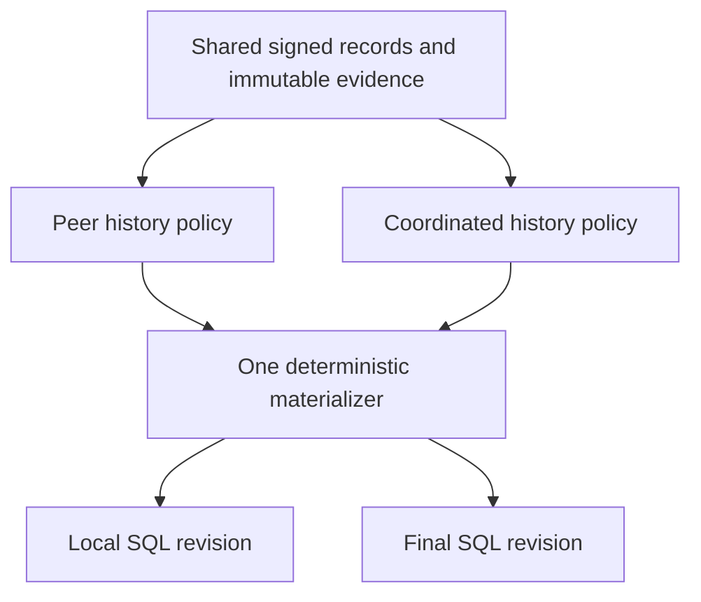

# Chronolog Design

Status: current design of the unreleased prototype. The transaction contract
is [Specification 10](implementation-specs/10-deterministic-sql-transactions.md);
membership details are in [governance.md](governance.md); row ownership is in
[design-owner-rows.md](design-owner-rows.md).

## 1. What Chronolog is

Chronolog is a permissioned, peer-to-peer SQL database. Members write
**ordinary SQLite transactions**; every replica derives the same database by
executing authenticated proposals in the order established by its group's
history policy. A signed genesis chooses one of two built-in policies:
**peer**, using validator admission and closure evidence, or **coordinated**,
using an authenticated ordered prefix and a fixed authority's certificates.

Peers durably prepare their own proposals, retain records and proofs, verify
history, and execute SQL locally. Under the peer policy, a late admitted
proposal can change the tentative suffix. Under the coordinated policy, an
offline proposal joins the ordered log when submitted. Neither policy permits
new arrivals to change an already applied final prefix.

Authenticated records and immutable evidence are the replicated source of
truth; SQL databases and their publication metadata are derived state. A
replica can rebuild from a peer without contacting a particular relay. Peer
groups can establish new finality without Tendriller or another coordinating
authority.

## 2. Moving parts

A group selects one policy. Both use the same record/evidence storage,
governance, transaction codec, node orchestration and materializer.

| Piece | Package |
| --- | --- |
| Signed messages, transaction and value codecs, execution manifest | `protocol`, `canonical`, `crypto` |
| Membership: genesis, capability revisions, validation policy | `capabilities` |
| Signed feed records, immutable evidence, durable storage ports and replication | `records` |
| Native authenticated SSB connection and SQLite storage | `transport-ssb` |
| Optional Tendriller connection and prefix authority composition | `transport-tendriller` |
| Node: ingest, history policy, membership activation, enrollment and finality | `node-core`, `control-store` |
| Deterministic execution on DoltLite | `materializer-doltlite`, `materializer` |
| Dedicated Worker, OPFS storage, Web Locks and WASM engine | `runtime-browser` |
| Client API, RPC, React hooks, CLI, daemon | `client`, `rpc`, `react`, `apps/*` |
| Experimental workerd execution path | `runtime-workerd` ([plan](workerd-reconstruction-plan.md)) |

## 3. Transactions

A transaction candidate is signed by its author and carries:

- the group, membership revision and validation policy it was written for;
- `author_timestamp_ms`, fixed by the author;
- the execution manifest digest (engine build, platform code and limits);
- a program: an ordered list of steps, each a SQLite statement with bindings
  or a typed platform operation (grant, collective,
  transfer).

The proposal ID is the digest of its canonical transaction core. Signatures,
encryption envelopes and outer feed records carry that proposal without
changing its identity. Receiving it through another peer, or inside another
outer feed record, does not create another transaction or SQL effect.

Values are SQLite's own storage classes (NULL, INTEGER, REAL, TEXT, BLOB).
DDL and DML travel in the same stream. Application schema is whatever the
accepted transactions created; the execution manifest identifies the engine
and execution rules, not the application's tables.
Only schema administrators (admins of the `group` collective, starting with
the root administrator) may run DDL.

A transaction that depends on earlier state says so in SQL, usually with
`chronolog_assert(condition, 'code')`. If any statement fails, the transaction
is **rejected** and has no effect; otherwise it is **accepted**. Only the
outcome (and a rejection code and step index) is recorded. Values
returned by statements are not replicated.

An application's stable operation ID is durably bound to the exact prepared
proposal before publication. A lost response or restart resumes that proposal
with its original identity; an established final outcome remains unchanged.
The shared operation journal serializes
unfinished work before dependent work can be authored. A relay adapter retries
the original local record and envelope bytes; it does not keep another outbox.

## 3a. Owner-controlled rows

Every application table is put under owner checks when it is created (no
extra step) and has a `chronolog_owner` column,
stamped with the signer of the transaction that inserted the row (stored as
a small integer id; `chronolog_principals` maps ids to keys).
Platform-generated triggers, enforced by the pinned engine on every replica,
let only the owner, a collective the signer belongs to, or a key the owner
granted access insert, update or delete a row. The root administrator and
schema administrators are ordinary actors under these checks: they cannot
widen anyone's rights, but they may narrow them with ordinary app triggers,
whose writes are themselves checked as the signer. Any violation aborts the
whole transaction (`policy:<table>:<command>`); rows are never skipped.
Ownership moves only by an offer accepted by the recipient; a planned key
change is a bulk transfer. Reads are not restricted: every reader node holds
every row. See [design-owner-rows.md](design-owner-rows.md).

## 4. Determinism

Every replica runs the pinned execution profile on the same state in the same
policy-supplied order. Native and browser hosts inject the storage and engine
adapters; the SQL materializer and deterministic restrictions are shared. The
engine inputs that do not come from SQL are fixed per
transaction: `'now'` is the author timestamp, `random()` is seeded from the
transaction id, `localtime` is UTC, connection counters start at zero, and
`chronolog_actor()` is the signing key. Platform operations are trusted
TypeScript whose digest is part of the execution manifest. A
short block-list (attachments, transaction control, writing pragmas, temporary
objects, Dolt functions, Chronolog's own tables, storage-dependent functions)
is enforced by SQLite's authorizer. SQL within the declared profile runs under
those checks. Replicas' state digests can be compared (snapshots and the chaos
harness do), so a missed case is detectable rather than silent.

An unavailable or incompatible execution manifest blocks application. Missing
records and decryption keys also block progress. None of these conditions is
converted into a deterministic SQL rejection; the replica retains its previous
applied final revision while waiting for the required input or engine.

## 5. Admission and order

### Peer policy

The signed configuration fixes the validator set and validation policy. A
validator attests a candidate if its author may write and its author timestamp is above the
validator's **acceptance cutoff**: a durable, monotonic bound that trails the
validator's clock by the group's `cutoff_lag_ms`. A candidate is **admitted**
once the attestations a replica sees satisfy the pinned validation policy
(at least N distinct validators). Admission is monotonic.

Admitted transactions are ordered by the immutable key

`(author_timestamp_ms, signing_public_key, proposal_id)`.

The node fixes the transport-sequence component of the underlying order key
to zero. Outer feed sequence is replication and fork evidence; it cannot move
a proposal when the same signed content travels over another connection.

Validators never choose the position; more attestations never move it. A
transaction that becomes visible late sorts into its fixed position in the
tentative suffix, which is replayed without changing the final prefix.

Validators publish **heartbeats** with their current cutoff. Once the feeds
of a blocking set of validators are replicated past heartbeats whose cutoffs
exceed time T, no new transaction can be admitted at or before T: everything
before T can become final once the necessary records are present and applied.
Live reader/writer membership changes additionally use signed validator
closures: each fixed validator durably closes the previous revision, and a
replica verifies the complete preceding admission records before activating the
next one. An admission published after that validator's closure cannot count
for the closed revision.

### Coordinated policy

The configuration fixes the group and genesis, execution manifest, history ID
and authority key. Ordered entries bind exact record bytes to contiguous
positions through a rolling hash. The authority reads its configured log's
committed head and signs a prefix certificate; it does not execute SQL.

A replica accepts a final prefix only after verifying that certificate and
every preceding entry. Canonical position determines order. Author timestamps
remain deterministic SQL inputs and metadata; backdating cannot insert a
later submission into an earlier prefix or bypass a revocation.

Certificates are immutable evidence outside the log they certify. The
optional Tendriller adapter maps its public record format to this policy;
the same verifier works against an independent reference log. A stored append
acknowledgment proves neither finality nor SQL success.

## 6. Replication

Each author has an append-only, hash-chained **feed** of signed records
(candidates, attestations, heartbeats and governance messages). The shared
record store also retains content-addressed immutable evidence. Certificates
do not need a mutable author feed or consume its sequence numbers.

The native adapter uses SQLite; the browser runtime supplies durable OPFS
stores. A signed feed record is appended only if it is the next one of its
feed, so feeds have no gaps; a second record at an existing
sequence is kept as fork evidence and quarantines that feed.

The native connection uses Secure Scuttlebutt's authenticated secret handshake.
On each connection a node asks the peer for every feed it wants, after its local
head, and keeps the stream open for new records. A node wants its own feed,
its configured peers' feeds, the administration feed and the feed of every
granted member, so records relay through any connected member. There is no
record size limit beyond that adapter's configurable maximum (64 MiB by
default). Other connections apply their own explicit bounds.

The portable in-process connection exchanges the same signed records and
evidence. The optional Tendriller connection submits exact candidate and
governance envelopes to a retained opaque log, stores returned order proofs in
the same evidence store, and uses existing authenticated connections for hints.
Hints trigger retained reads; they are never required for correctness. Quota
exhaustion, a changed history identity or conflicting restored history stops
progress visibly. Neither Chronolog core nor Tendriller core imports the other.

## 7. Membership and encryption

A group starts from a signed **genesis**; the root administrator then
publishes signed **capability revisions** on the administration feed. The
protocol represents writer, validator, reader and administrator roles; live
enrollment grants ordinary reader/writer membership. The built-in signed
configurations keep the root, administration feed, validator set and validation
policy fixed. Their authoring APIs reject reconfiguration of those components.

A joining device persists its own signing and reader keys and an exact signed
request. An authorized issuer approves explicit roles and historical access
through the live client/RPC workflow. Readiness requires active grants, the
required keys, the matching engine and application of the captured final
target. A descriptor supplies authenticated bootstrap configuration, not a
bearer grant. Database membership and a relay's host permissions are distinct.

Receiving governance does not activate it. Peer closures or a certified
canonical position determine when a new revision takes effect. Revocation is
prospective in that order: earlier final outcomes remain unchanged, and a later
regrant does not revive a revoked capability or a previously rejected proposal.

Records are encrypted with per-epoch keys. The administrator rotates epochs
and wraps each epoch key to every reader's HPKE key; historical epochs are
given to a reader only by an explicit administrator action. A replica can
receive verified governance and historical keys from a complete certified
prefix before replaying its earlier encrypted SQL. Membership activation still
occurs at each control record's canonical position.

## 8. Materialization

The node passes its selected policy's order to one materializer, which does
not independently re-sort it. Each published revision is a
Dolt commit (`chronolog_head`, `chronolog_rev_*`); checkpoints
(`chronolog_cp_*`) are kept every N transactions so a late arrival replays
only from the nearest checkpoint. Publication binds the durable SQL revision
to its applied prefix and reconciles control metadata after interruption.

Readers choose `local` or `final`. The local view contains admitted tentative
work. The final view uses an actual separate immutable SQL revision of the
locally applied final prefix; it is not a label on the tentative reader.
Queries and live queries report the selected view and revision. A replica's
final view can still be behind another replica's.

`transaction.final()` waits for final acceptance or rejection after local
application. `settled()` and `accepted()` describe the current result, which
can still change through peer-policy replay. See the
[client guide](../packages/client/README.md). The replicated
log of outcomes is the table `chronolog_transactions`, readable by
transactions.

## 9. Failure handling

Durable operation journals, exact-byte retries, retained records and verified
evidence recover interrupted submission, governance, replication and SQL
publication. A browser peer also requires one effective storage owner; losing
a tab does not discard its durable identity or proposal.

A node whose state is suspect restores from a verified snapshot or replays
authenticated history. The built-in policies do not provide root/authority
rotation, validator reconfiguration or automatic failover. If a required key
is lost, the fixed validators can no longer meet their policy, or final history
must change,
participants coordinate out of band and **fork**: a new group whose genesis
names its origin and is seeded by its root administrator, keeping every row's
owner ([governance.md](governance.md#forking-a-group)).

## 10. Security consequences

Signatures authenticate authors and governance; policy evidence authenticates
admission, order and finality. Feed forks and conflicting certified positions
are detected. Backdating cannot bypass a closed peer revision or a coordinated
revocation position, and duplicates cannot repeat SQL effects.

A writer can change rows it owns or has been granted. Validators decide
admission under the pinned policy; the replica also verifies writer authority
and enforces SQL ownership. Readers can retain what they were able to decrypt.
Writer/reader removal uses live governance and
reader-key rotation. Replacing a compromised fixed validator, root or authority
requires an intentionally new group configuration. See the
[threat review](security-threat-review.md).
