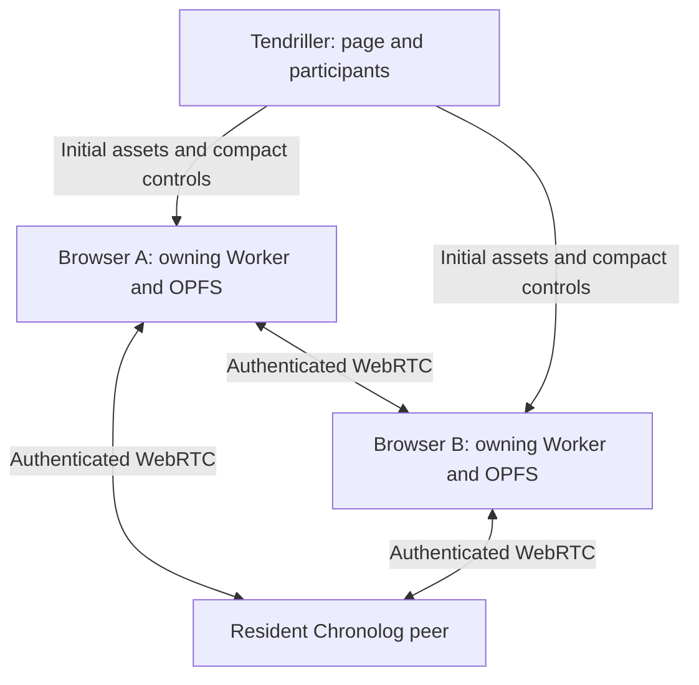

# Peer application architecture

Chronolog owns application data, peer authentication, live messages and finality.
Tendriller supplies the initial page and participant administration. A resident
Chronolog process supplies an independently reachable peer; its finality role is
optional and selected by the signed group descriptor. Ordinary application
traffic does not pass through a Cloudflare application API.

The edges show permitted connections, not a requirement for every device to
maintain a full mesh. A resident can relay original signed records and live
signals. The application chooses its reachable peers and ICE configuration.

## Responsibilities

| Component | Owns | Does not establish |
| --- | --- | --- |
| Tendriller host | Published assets, participant requests and approvals, compact signed membership state, initial resident hints | Application execution, application event delivery or finality |
| Browser Worker | Private keys, original signed records, durable operations, local materialization, peer sessions and live signals | Permission from a display name or a successful RTC connection |
| Resident peer | Durable replica, reachable HTTPS introduction endpoint, authenticated replication and verified relay | Finality merely by being online |
| Configured finality service | Inclusion receipts and signed closure commitments under the group descriptor | SQL execution order or external tool authority |
| Application effect worker | Final intent consumption and durable dispatch/reconciliation state | Exactly-once effects at a provider without idempotency or reconciliation |

The optional retained-log adapter remains an explicit deployment choice. The
peer composition does not silently fall back to it when WebRTC is unavailable.

## Three distinct application primitives

**Durable operations** append original signed proposals. Their operation IDs
survive retries and device restart. SQL and durable events are produced by the
same accepted change program. The client exposes local progress separately from
final acceptance; receiving a proposal or successfully sending a network frame
does not make it final.

**Live signals** use `Signals.send()` and `Signals.subscribe()` from
`@chronolog/signals`. A signal names its scope, author, session, sequence, topic
and expiry. The portable channel signs and verifies bounded frames without a
database, a finality service or a durable outbox. The governed composition binds
that channel to the currently verified topic grants. A relay keeps the original
signed frame and author identity.

Subscriptions select bounded FIFO delivery with `mode: 'all'`, or explicit
coalescing with `mode: 'latest'` for replaceable values such as typing. Live
messages have no replay cursor. A send is one attempt; reconnect does not resend
old signals, and an interrupted subscription is visible to its consumer.
Expired messages are not useful history. Applications requiring durable delivery
must publish a durable event instead.

**Final effects** consume final durable intents. A resident can run effect and
timer tasks independently of the device that authored an intent. An effect
worker records dispatch and reconciliation state and uses a stable provider
idempotency key where supported. A signal, a provisional event, and a signed
record are not themselves authorization to perform an external action.

## Public composition and ownership

Governed `BrowserPeer` and the SQL-free `BrowserEventPeer` expose `signals` and
`connectPeer({ connection, peerIdentity? })`. The connection method owns the
reader-authenticated handshake, replication attachment, live routes and cleanup.
Native applications receive the same composition through `context.signals` and
`context.connectPeer`. They do not write fixture-specific frame forwarding loops.

The low-level browser configuration that supplies its own `node` policy has no
implicit capability resolver. It can supply an explicit `SignalChannel` through
`configuration.signals`, with its own authorization and routes. Without that
channel, accessing `signals` fails with `PEER_GOVERNANCE_REQUIRED`. Its
`connectPeer` method requires governance; an application choosing the low-level
mode owns its connection composition explicitly.

The page uses the ordinary `ChronologClient`. Its `client.signals` crosses the
existing bounded Worker RPC boundary. A Tendriller page installs that port with
`tendril.signals.install(client.signals)`, independently of the durable
application backend. Installed, connected, authenticated, caught up and final
are separate states.

A browser peer can open before enrollment, and a reader can receive without a
writer grant. Sending selects and checks the current eligible topic grant when
the operation occurs. Reader and publisher permission are checked again across
asynchronous work; closing or replacing a session fences its late completions.
These checks use the replica's verified membership knowledge. They do not claim
instantaneous revocation knowledge across a partition.

## Cold start and quiet steady state

1. The host serves the page with immutable assets and an initial resident URL
   snapshot. Serving fresh HTML refreshes those hints without a separate
   background bootstrap request.
2. An enrolled device verifies compact membership controls and obtains the keys
   needed to authenticate. This does not mark application history applied.
3. An HTTPS request exchanges the WebRTC introduction with a reachable resident.
   ICE establishes the selected direct or relay route. The introduction request
   is then finished.
4. Chronolog authenticates the reader and exchanges original records, evidence,
   detached bodies and live signals over the peer connection.
5. A session supervisor observes the owned connection lifetime. Failure starts
   bounded reconnect attempts; a healthy connection needs no host polling or
   application keepalive timer. Reconnecting resumes durable synchronization,
   not expired live messages.

WebRTC's own ICE/transport maintenance can still use the configured network
services. A measured direct connection is different from a TURN relay. Browser
suspension, NAT traversal and unreachable residents remain deployment concerns;
the runtime reports observed routes instead of inferring them from configuration.

## Compact membership and independent finality

The signed-inclusion-v2 closure commits a cumulative control count and root. A
thin administrator retains original governance controls and the certificate
that covers them; it does not retain application descriptors or bodies. Partial
pages are staged within explicit bounds and do not activate grants or persist a
verified checkpoint until the authenticated commitment matches. Synchronization
pins the target it first authenticated, so concurrent application traffic cannot
move that target indefinitely.

A full replica separately checks the control projection against its complete
receipt history. It still needs original peer history to establish the captured
application frontier. Control receipt progress, verified control progress,
application receipts, checkpoints and closed author time are distinct.

The canonical native finality service opens from the verified enrollment
descriptor and derives its timing policy from signed genesis. A resident that
does not hold the configured finality identity exposes `context.finality` as
`null`. Live authorized connections can continue while coordinated finality is
unavailable; new coordinated final decisions wait for the service to return.

See [compact proof semantics](membership-control-proofs.md),
[portable peer history](portable-peers.md),
[resident lifecycle and effects](../packages/agent-service/README.md), and
[WebRTC transport](../packages/transport-webrtc/README.md) for the implementation
contracts. The prerelease protocols are replaced directly; there is no migration
or compatibility layer for the retired host framing or live-signal APIs.
